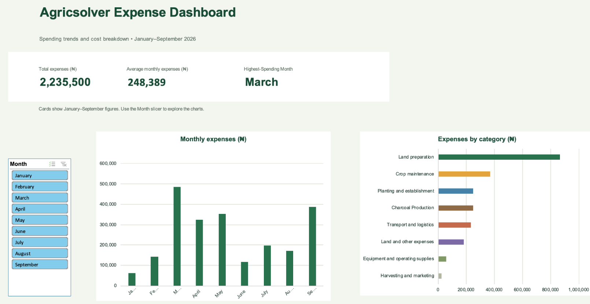
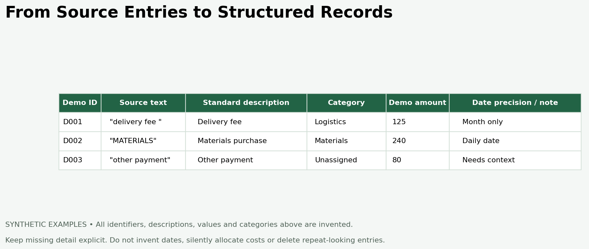

# Agricultural Expense Reporting and Data Management

**Aderinwale John O. · Data Analyst · Microsoft Excel**

I developed an Excel expense-reporting workflow for an agricultural business, turning source expense records into structured categories and a management dashboard. This case study explains the methods and reporting decisions without publishing the client's records or findings.

**Confidentiality:** Business records are withheld. All displayed figures, example entries and preview categories are synthetic. Images are recreated portfolio illustrations, not screenshots of the client's Excel workbook.

## The business problem

Expense records needed a consistent structure that would let the owner review spending over time and compare types of expenditure. The immediate deliverable was an expense dashboard. The broader responsibility covers business data management and the future inclusion of sales and revenue.

## My contribution

- Organised expense records into identifiers, source descriptions, standard descriptions, reporting periods, categories and subcategories.
- Standardised descriptions and classification labels while retaining source wording for traceability.
- Built Excel reporting with PivotTables, PivotCharts, KPI cards and a Month slicer.
- Prepared management insights and recommendations, including better checks when records are collected and collated.
- Defined the next phase: database storage and incremental loading of subsequent records.

## Dashboard preview

The illustration shows the reporting concepts: period comparisons and category breakdowns. Its values and categories are invented and do not reproduce the business's actual spending distribution. The private workbook contains the operational dashboard; it is not distributed with this portfolio.

### Why these views

| Reporting element | Question it supports | Design judgement |
| --- | --- | --- |
| Period spending trend | When are cash requirements concentrated? | Use chronological periods; a peak alone does not prove seasonality. |
| Category breakdown | Which activities account for spending? | Keep classifications consistent; spending size alone does not establish waste. |
| KPI cards | What is the reporting scope and overall expense position? | Label period and filter scope so a total is not mistaken for a filtered result. |
| Month slicer | How does the chart view change for a selected period? | Distinguish chart filtering from fixed full-period KPI cards. |

## Cleaning and modelling decisions

The example illustrates the approach rather than exposing client entries.

1. **Preserve provenance.** Keep original descriptions beside standard descriptions so a reporting label can be traced back to its source.
2. **Respect date precision.** Retain month-level records as month-level records; do not fabricate daily dates to populate a column.
3. **Separate broad and detailed labels.** Main categories support management comparisons; subcategories retain useful operational detail.
4. **Make uncertainty visible.** Retain review flags and unspecified labels when source evidence does not support a more precise interpretation.
5. **Avoid double counting.** Treat source summary totals as comparison controls rather than additional expense transactions.
6. **Use stable identifiers.** Identifiers support traceability and provide a foundation for future database loading. A repeated amount or description is not sufficient evidence that two expenses are duplicates.

## Validation approach

The workbook includes monthly reconciliation and review fields. The reporting workflow separates transaction records from summary controls and checks that category and period summaries refer to the same expense population. Source totals are useful where available; matching them does not make the underlying records audited or complete.

A publication-safe demonstration does not include source images, raw rows, reconciliation exceptions or internal quality findings. Those remain part of the private business work.

## Management deliverable

The completed expense-reporting phase gives the owner a consolidated dashboard and supporting recommendations. Recommendations address clearer descriptions, complete dates where available, consistent classification, supporting evidence and checks at recording and collation points.

This case study does not claim measured savings, profit improvements or revenue growth. Expense-only analysis cannot establish profitability, unit economics or budget performance without the relevant revenue, output and budget records.

## Database roadmap — planned work

| Stage | Intended implementation | Completion evidence |
| --- | --- | --- |
| Historical migration | Load existing records into a relational database with appropriate types and identifiers. | Reconcile imported record counts and totals to the approved source. |
| Incremental ingestion | Add new records through a repeatable loading process with source tracking. | Show that replaying the same batch does not create unintended duplicates. |
| Corrections | Define how amendments to existing records are identified and applied. | Preserve traceable changes and reconcile corrected reporting totals. |
| Operational checks | Validate required fields, dates, classifications and amounts; retain rejected records for review. | Demonstrate accepted, rejected and corrected examples using synthetic data. |
| Sales and revenue | Extend the model when those records are available and their meaning is agreed. | Validate relationships and prevent joins from multiplying financial totals. |
| Reporting refresh | Feed consistent reporting outputs into the dashboard. | Check database summaries against displayed metrics. |

These are proposed next steps, not completed features. No database engine, automation schedule or production pipeline is claimed for this business yet.

## Skills demonstrated

Excel reporting, PivotTables, dashboard design, expense classification, data cleaning, source traceability, reconciliation, handling incomplete data, and communicating practical recommendations to a business owner.

## Repository contents

- `README.md` — this case study.
- `images/dashboard-overview.png` — synthetic reporting preview.
- `images/cleaning-example.png` — invented before-and-after record example.

The original workbook, client records, source images and actual financial findings are intentionally excluded.
