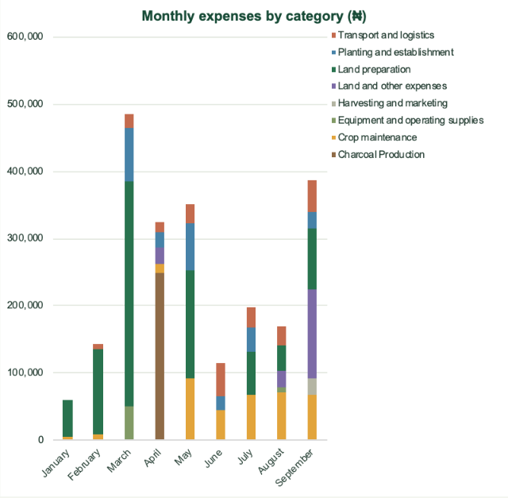

# Agricultural Expense Reporting and Data Management

**Aderinwale John O. · Data Analyst · Microsoft Excel · PostgreSQL · SQL**

I developed an expense-reporting workflow for an agricultural business, combining a structured PostgreSQL expense database with Excel management reporting. This case study presents selected dashboard outputs and explains the cleaning, reporting and validation decisions behind them.

**Confidentiality:** Selected reporting outputs are shared with the business owner's permission. Dashboard screenshots contain actual aggregate figures. Underlying transaction records, source documents and the original workbook are withheld. The cleaning example is entirely synthetic and is labelled separately.

## The business problem

Expense records needed a consistent structure that would let the owner review spending over time and compare types of expenditure. The immediate deliverable was an expense dashboard. The broader responsibility covers business data management and the future inclusion of sales and revenue.

## My contribution

- Organised expense records into identifiers, source descriptions, standard descriptions, reporting periods, categories and subcategories.
- Standardised descriptions and classification labels while retaining source wording for traceability.
- Built Excel reporting with PivotTables, PivotCharts, KPI cards and a Month slicer.
- Prepared management insights and recommendations, including better checks when records are collected and collated.
- Imported historical expenses into PostgreSQL and reconciled record counts, distinct identifiers and financial totals with Excel.
- Created monthly expense and category views, plus sales/payment tables, a sales balance view and an unmatched-payment check.
- Prepared capture templates for future records and created a database backup.

## Excel dashboard

This cropped screenshot shows the operational Excel dashboard, including full-period KPI cards, a Month slicer, monthly spending and expense categories. It covers January–September 2026. Excel controls and surrounding blank space were cropped out; the displayed figures and chart content were not altered.

The cards show the full reporting period. The Month slicer filters connected PivotCharts, not the fixed full-period cards. This image is a static capture; slicer interaction is available in the private workbook.

## Monthly expense composition

The stacked chart shows how the category mix contributes to recorded spending in each month. It supports discussion of funding needs and activity timing without publishing transaction-level records. A spending peak is a prompt for investigation, not evidence of inefficiency or a recurring seasonal pattern.

### Why these views

| Reporting element | Question it supports | Design judgement |
| --- | --- | --- |
| Period spending trend | When are cash requirements concentrated? | Use chronological periods; a peak alone does not prove seasonality. |
| Category breakdown | Which activities account for spending? | Keep classifications consistent; spending size alone does not establish waste. |
| KPI cards | What is the reporting scope and overall expense position? | Label period and filter scope so a total is not mistaken for a filtered result. |
| Month slicer | How does the chart view change for a selected period? | Distinguish chart filtering from fixed full-period KPI cards. |

## Cleaning and modelling decisions

The example illustrates the approach rather than exposing client entries.

1. **Preserve provenance.** Keep original descriptions beside standard descriptions so a reporting label can be traced back to its source.
2. **Respect date precision.** Retain month-level records as month-level records; do not fabricate daily dates to populate a column.
3. **Separate broad and detailed labels.** Main categories support management comparisons; subcategories retain useful operational detail.
4. **Make uncertainty visible.** Retain review flags and unspecified labels when source evidence does not support a more precise interpretation.
5. **Avoid double counting.** Treat source summary totals as comparison controls rather than additional expense transactions.
6. **Use stable identifiers.** Identifiers support traceability and provide a foundation for future database loading. A repeated amount or description is not sufficient evidence that two expenses are duplicates.

## Validation approach

The workbook includes monthly reconciliation and review fields. The reporting workflow separates transaction records from summary controls and checks that category and period summaries refer to the same expense population. Source totals are useful where available; matching them does not make the underlying records audited or complete.

Source documents, raw rows, reconciliation exceptions and internal quality findings remain private. Only the selected aggregate dashboard views are included.

## Management deliverable

The completed expense-reporting phase gives the owner a consolidated dashboard and supporting recommendations. Recommendations address clearer descriptions, complete dates where available, consistent classification, supporting evidence and checks at recording and collation points.

This case study does not claim measured savings, profit improvements or revenue growth. Expense-only analysis cannot establish profitability, unit economics or budget performance without the relevant revenue, output and budget records.

## PostgreSQL implementation

The initial database is implemented with three tables:

| Table | Purpose | Current state |
| --- | --- | --- |
| expenses | Store historical expense entries with classifications, source references and optional exact dates. | Historical data imported and reconciled. |
| sales | Store product-level sale lines with quantity, unit price and discount; calculate line value in PostgreSQL. | Structure created; no real sales records loaded yet. |
| sales_payments | Record receipts separately from sales to support instalments and outstanding balances. | Structure created; no real payment records loaded yet. |

Reporting views cover monthly expenses, expense categories, sale balances and unmatched payment references. Sales and payments are aggregated separately before joining, avoiding multiplication of totals when a sale contains multiple lines and payments.

Expense constraints enforce unique IDs, valid reporting months, nonnegative amounts and agreement between an exact date and its reporting period. The unmatched-payment view detects references not found in sales; the sale-to-payment relationship is not yet enforced by a foreign key.

### Validation and backup

After the historical CSV import through pgAdmin, I checked record counts, unique IDs and the total against the source workbook, followed by monthly and category summaries. The sales views currently return empty results because no real sales/payment records have been loaded; transaction scenarios have not yet been validated with real data.

A database backup has been created. A restore drill remains to be completed. The existing Excel dashboard is not yet connected directly to PostgreSQL.

### How subsequent records will be handled

New handwritten records will be scanned, transcribed into the agreed templates, checked against their sources and manually imported as new batches. Stable expense IDs prevent reuse of an existing ID. They do not detect a duplicated handwritten transaction assigned a different ID, so an imported-page checklist remains necessary. Repeated CSV imports fail on existing IDs rather than automatically skipping them.

### Next steps

- Validate sales, instalments and unmatched-payment scenarios using synthetic records in an isolated test environment.
- Test backup restoration.
- Establish a reporting refresh connection or controlled export to Excel.
- Add automated incremental loading and traceable correction handling if the volume justifies it.

Python ingestion, scheduled loading, automatic duplicate resolution and a live Excel database connection are not implemented for this business.

## Skills demonstrated

Excel reporting, PivotTables, dashboard design, PostgreSQL table design, SQL views, CSV imports, financial reconciliation, source traceability and handling incomplete data.

## Repository contents

- `README.md` — this case study.
- `images/dashboard-overview.png` — cropped screenshot of the actual Excel dashboard.
- `images/monthly-category.png` — cropped screenshot of the actual monthly category chart.
- `images/cleaning-example.png` — invented before-and-after record example.

The original workbook, transaction-level client records and source documents are intentionally excluded. Selected aggregate financial information appears in the dashboard screenshots with permission.
